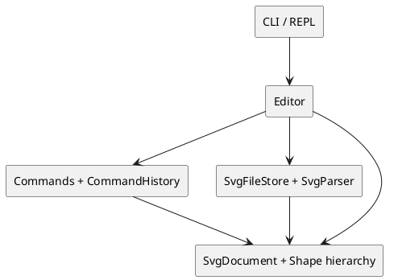
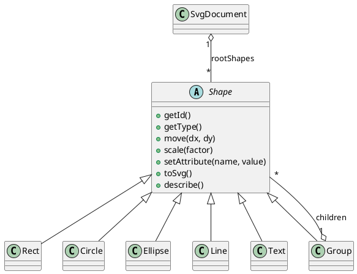

# PJ1 Phase 1：TypeScript CLI SVG 编辑器

## 项目概述

本项目是一个基于 TypeScript 的命令行 SVG 编辑器。用户在 `svg>` 提示符中输入命令，创建、读取、保存 SVG 文档，并完成图形创建、编辑、分组、查看层级和撤销/重做。

本阶段内置 `rect`、`circle`、`ellipse`、`line`、`text` 和 `g` 六种图形。`box` 是作业说明中的后续插件化阶段功能，本项目不实现。

## 运行、验证与 SVG 预览

在项目根目录执行：

```bash
npm install
npm run build
npx tsc -p tsconfig.test.json
npm run test
npm run cli
```

`save` 生成的是标准 SVG 文件，可直接用浏览器看到效果。这正是作业说明推荐的预览方式；不需要额外开发 GUI。

```text
svg> init 400 200
svg> create g flow
svg> create rect start 30 70 120 60 #4a90d9 in flow
svg> create line edge 150 100 250 100 black in flow
svg> create rect end 250 70 120 60 #f5a623 in flow
svg> save demo.svg
```

退出 CLI 后，在 macOS 终端执行 `open demo.svg`，或把该文件拖进 Chrome、Edge、Firefox。浏览器会直接渲染 SVG；修改并再次保存后刷新页面即可看到更新。也可以在 VS Code 安装 **SVG Preview** 扩展后，在编辑器中预览 `demo.svg`。

### 命令总览

| 类别 | 命令 |
| --- | --- |
| 文档 | `init [w] [h]`、`read <file.svg>`、`save [file.svg]`、`canvas [w] [h]` |
| 创建 | `create <type> <id> [params...] [style] [in <containerId>]` |
| 编辑 | `move <id> <dx> <dy>`、`scale <id> <factor>`、`set <id> <attr> <value>`、`delete <id>` |
| 分组 | `group <newGid> <id...>`、`ungroup <gid>`、`addto <gid> <id>` |
| 图层 | `front <id>`、`back <id>` |
| 显示 | `tree [id]`、`show <id>`、`canvas`、`help` |
| 历史 | `undo`、`redo` |
| 退出 | `exit`、`quit` |

兼容早期演示，`show` 不带参数时会输出整份序列化 SVG；验收所要求的 `show <id>` 会显示单个图形的父级与属性明细。

创建参数遵循作业表：`rect x y w h [fill]`、`circle cx cy r [fill]`、`ellipse cx cy rx ry [fill]`、`line x1 y1 x2 y2 [stroke]`、`text x y "content"`、`g`。样式既可以写成位置参数（如 `red` 或 `#4a90d9`），也可写成 `fill=red`、`stroke=black`。

以 `#` 开头的输入行会被当作注释忽略。图形 ID 全局唯一且大小写敏感；所有用户可见错误都以 `error:` 开头，失败命令不会改变已有文档。

`init`、成功 `read`、成功 `save` 与修改画布尺寸后会清空历史并暂时禁止 `undo` / `redo`；下一条成功的编辑命令会重新启用它们。这与题目给出的文档类命令规则一致。

## 架构方案

### 模块划分

| 模块 | 目录 | 职责 |
| --- | --- | --- |
| CLI | `src/cli/` | REPL、命令文本分词、参数校验、提示和统一错误输出 |
| 应用层 | `src/app/` | 协调当前文档、历史、文件路径、命令对象和领域模型 |
| 领域模型 | `src/model/` | `SvgDocument`、图形类层次、树关系、SVG 序列化和多态操作 |
| 编辑命令 | `src/commands/` | Command 模式的编辑操作、撤销栈和重做栈 |
| SVG I/O | `src/io/` | UTF-8 文件读写、受支持 SVG 子集的解析、缺失 ID 警告 |
| 测试 | `test/` | 模型、命令、CLI 及 I/O 的自动化测试 |

### 组件图



### 图形结构图



### 设计模式与面向对象设计

- **Command 模式**：`CreateShapeCommand`、`MoveCommand`、`ScaleCommand`、`DeleteShapeCommand`、`SetAttributeCommand`、`MoveToGroupCommand`、`GroupShapesCommand`、`UngroupCommand` 和 `ReorderShapeCommand` 实现统一接口。`CommandHistory` 维护撤销与重做栈；成功的新编辑会清空 redo 栈。
- **Composite 模式**：`Shape` 是抽象基类，基础图形是叶子，`Group` 是可包含图形的组合对象。因此 `move`、`scale`、`set`、`delete`、序列化和结构显示可统一作用于叶子与容器。
- **Factory 模式**：`ShapeFactory` 用注册表集中维护类型名到具体图形类的映射，也为 SVG 解析器提供各类型的参数定义，避免在 CLI、Editor、Parser 中散布 `switch(tag)`。
- **封装与多态**：几何字段和样式字段均为类的私有状态；外部只能经由行为方法改变它们。
- **I/O 隔离**：`SvgFileStore` 和 `SvgParser` 处理文件与 XML 文本，领域模型不依赖终端或文件系统。

### 依赖方向规则

```text
cli -> app -> commands / io / model
commands -> model
io -> model
model -> （不依赖其他业务模块）
```

这样 CLI 不直接操作图形树，命令对象不处理文件，模型也不会反向依赖界面或文件系统。

### 变化点假设

| 可能变化 | 当前应对方式 |
| --- | --- |
| 新增图形类型 | 新建 `Shape` 子类，在 `ShapeFactory` 注册，并补充模型与 CLI 测试 |
| 新增编辑命令 | 新建 `EditorCommand` 实现，在 `Editor` 与 CLI 注册 |
| 新增 SVG 属性 | 由具体图形类维护白名单，不使用自由属性数据袋 |
| SVG 读写规则变化 | 修改 `io` 层，不把 XML 细节泄漏到领域模型 |
| 外部 SVG 缺少 ID | 解析时按“标签名 + 序号”补齐并通过 CLI 给出 warning |
| 后续 `box` 插件 | 本阶段不预先实现插件框架；新增时可在工厂注册机制上扩展 |

### 待重构项

作业允许“按名称分派”出现在命令分发和图形工厂两处。目前：

1. `CommandRunner` 的 `Map<命令名, 处理器>` 负责命令分发；未来可替换为独立的命令注册表，以支持插件命令。
2. `ShapeFactory` 的类型注册表负责图形类型分发；未来可公开注册接口，使 `box` 等插件不必修改内核。

这两处是受控、集中的待扩展点；其余层不按 SVG 标签名做分派。

## 与 AI 协作的过程记录

1. 先根据作业说明界定 Phase 1：内置图形为 `rect`、`circle`、`ellipse`、`line`、`text`、`g`，而 `box` 不属于本阶段。
2. 与 AI 讨论后按 CLI、应用、模型、命令、I/O、测试划分目录，并采用 Command + Composite 作为核心设计。
3. 初次编译提示缺失 Node 类型时，安装并启用 Node 类型定义，而不是用手写 `process` / `require` 声明绕过检查。
4. TypeScript 严格模式发现命令参数下标可能为 `undefined`，因此在 `CommandRunner` 中显式验证参数数量与存在性。
5. 初次测试文件误放入 `src/`，导致构建产物中的 Vitest 重复执行；随后将测试移到 `test/` 并新增 `tsconfig.test.json`。
6. 文本 SVG 序列化曾多出空格，自动化测试发现后改为直接模板字符串，保证文字内容不被改变。
7. 实现 `Group` 时把父容器关系放入 `Shape` 基类，由 `Group` 维护子节点、顺序和循环引用保护。
8. 实现 `SvgDocument` 的顶层树管理、全局 ID 唯一性、嵌套查找、删除/恢复及完整 SVG 序列化。
9. 先完成创建、移动、缩放，再以可撤销命令扩展 delete、set、addto、group、ungroup、front/back，测试每条命令的一次 undo / redo。
10. 在实现 `read` 后复核题目，发现早期版本仍有 `addto` 参数顺序、`create ... in`、`tree [id]`、`show <id>`、无参数 `save` 和 I/O 后撤销锁定等不一致；据此调整了命令语义并补充回归测试。
11. SVG 解析器原本含有按标签名的分支。随后将类型参数知识移入 `ShapeFactory` 注册表，使 Parser 只负责 XML 结构与属性读取。
12. 读取外部 SVG 时，增加题目示例中的 `<g transform="translate(...) scale(...)">` 归一化支持，以及 `text-anchor`、`font-size` 的保留测试。
13. VS Code 无法使用 TypeScript 7 的传统 `tsserver.js` 布局，因此固定项目 TypeScript 为 5.9.3，再次通过构建、类型检查和测试确认环境恢复正常。

## 一致性自查

### 模块划分

- `src/cli/`、`src/app/`、`src/model/`、`src/commands/`、`src/io/` 和 `test/` 均存在，和架构方案一致。
- 每个图形类独立成文件；`Group` 也是 `Shape`，符合 Composite 语义。
- 编辑操作统一以命令对象进入 `CommandHistory`；文档类操作通过应用层重置历史并锁定 undo/redo。
- `read` 先完整解析，再替换当前文档；读入失败时旧文档和历史状态保持不变。
- 修订记录中已记录了命令语法和 Parser 分派的修正，没有把早期实现误写成最终行为。

### 依赖方向

抽样检查 `CommandRunner -> Editor`、`Editor -> commands/io/model`、`commands -> model`、`io -> model` 均符合设计。`model` 未反向依赖 CLI、应用层、命令层或 I/O 层；目前未发现违反依赖方向的引用。

## 功能完整性和质量保证

当前验证命令：

```bash
npm run build
npx tsc -p tsconfig.test.json
npm run test
```

保障措施：

- TypeScript 严格编译和源代码/测试代码联合类型检查均通过。
- Vitest 覆盖基础图形、组合图形、文档树、图形工厂、SVG 保存/读取、缺失 ID、解析失败、`transform` 归一化、文字排版属性、全部 CLI 命令、错误处理及 undo/redo。
- 手工执行了带 `in` 子句的流程图创建、`tree`、`show <id>`、跨父级 `group`、顶层 `ungroup` 拒绝、无参数 `save`、浏览器预览文件输出，以及 I/O 操作后的 undo/redo 锁定。
- 每个功能阶段使用 Git 小步提交并推送远程仓库；最终版本会使用 `final` 标签。

已知边界：`read` 面向本项目支持的 SVG 子集，不支持 `path`、滤镜、动画、CSS 样式表等任意 SVG 特性。支持的 `<g>` 变换限定为 `translate(...)` 和等比 `scale(...)`，并在读入后归一化为可继续编辑的几何数据。遇到不支持的元素或属性时，命令返回 `error:` 且不会替换当前文档。
