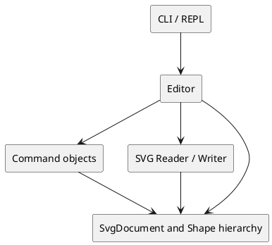

# SVG CLI Editor

## 项目概述

本项目是一个基于 TypeScript 的命令行 SVG 编辑器。用户通过 `svg>` 提示符输入命令，完成 SVG 文档的创建、读取、保存，以及图形的创建、编辑、分组、查看与撤销重做。

当前开发环境：

- Node.js + TypeScript
- Git + GitHub
- Vitest（后续用于自动化测试）

运行方式：

```bash
npm install
npm run cli
```

编译检查：

```bash
npm run build
```

## 架构方案

### 模块划分

| 模块 | 目录 | 职责 |
| --- | --- | --- |
| CLI | `src/cli/` | REPL 输入输出、命令文本解析、用户可见的错误与提示信息 |
| 应用层 | `src/app/` | 协调编辑器状态、当前文档和后续的撤销/重做历史 |
| 领域模型 | `src/model/` | SVG 文档、图形类层次、父子关系和图形操作语义 |
| 编辑命令 | `src/commands/` | 后续实现 Command 模式：每条编辑命令的执行、撤销和重做 |
| SVG 读写 | `src/io/` | 后续负责 SVG XML 的读取、自动补 id 与序列化保存 |
| 测试 | `test/` | 单元测试、命令回归测试和 SVG 读写测试 |

当前已实现 `cli`、`app` 与 `model` 的最小骨架；`commands`、`io` 会在对应功能开始前创建，避免空目录和无用代码。

### 组件图



最终提交前会将这份 PlantUML 架构图渲染为图片并嵌入本文档。

### 设计模式的选择

- **Command 模式（必需）**：每条编辑操作会对应一个命令对象，例如 `CreateCommand`、`MoveCommand`、`DeleteCommand`。命令对象提供执行和撤销能力；`Editor` 维护 undo/redo 栈，保证“一条编辑命令对应一个撤销单元”。
- **Composite 模式**：`Shape` 是抽象图形，`Rect`、`Circle` 等是叶子图形，`Group` 是可包含子图形的容器。因而叶子和容器都可统一执行移动、缩放、删除等操作。
- **Factory 模式**：后续通过 `ShapeFactory` 根据 `create` 命令中的类型名称创建不同图形类。按类型名称分派被集中在工厂中，不扩散到业务代码。
- **封装与多态**：图形属性保留在对应图形类内部，通过方法修改；避免将图形表示成公共字段数据袋，再通过大量 `switch` 处理类型。

### 依赖方向规则

依赖方向如下：

```text
cli -> app -> commands / io / model
commands -> model
io -> model
model -> 无其他业务模块
```

理由：

- `model` 是核心业务概念，不应依赖终端、文件或命令解析。
- `commands` 和 `io` 只操作领域模型，不能反向依赖 CLI。
- `cli` 只负责交互，不直接修改图形内部字段。
- `app` 作为编排层协调各模块，但不承担具体图形算法。

当前代码中的依赖为 `cli -> app -> model`，符合上述规则。

### 变化点假设

| 可能变化 | 应对方式或取舍 |
| --- | --- |
| 新增图形类型 | 通过 `Shape` 抽象类和 `ShapeFactory` 集中扩展 |
| 命令语法增加 | 命令分发集中在 CLI，不让语法解析进入图形类 |
| 新增 SVG 属性 | 每种图形类维护自身白名单，避免全局自由属性表 |
| SVG 读取或保存规则变化 | 隔离在 `io` 模块，领域模型不处理 XML 文本 |
| 后续插件图形 `box` | 本阶段明确不实现；不为未要求的插件系统提前增加复杂度 |

## 与 AI 协作的过程记录

1. 根据作业说明确认 Phase 1 的范围：内置图形仅包含 `rect`、`circle`、`ellipse`、`line`、`text`、`g`；`box` 是后续插件阶段目标，本阶段不实现。
2. AI 协助制定了模块边界和 Command + Composite 的设计方案。实现时先完成 `SvgDocument`、`Editor` 与 CLI 的最小闭环，再扩展图形和命令。
3. 初次编译时，TypeScript 提示缺少 Node 类型。没有通过手写 `process`、`require` 的伪声明绕过错误，而是启用 `tsconfig.json` 中的 `"types": ["node"]`，保留真实类型检查。
4. TypeScript 严格模式发现命令参数数组下标可能不存在。随后在 `CommandRunner` 中显式验证命令参数数量和 `undefined` 情况，使错误输入不会改变文档状态。
5. 在本机终端中，`readline.close()` 未能按预期结束 CLI。经手工验证后，退出命令改为打印 `bye` 并显式结束进程。
6. 初次测试文件被误放在 `src/`，导致 TypeScript 将测试编译到 `dist/`，Vitest 因此重复执行测试。随后将测试移动到 `test/`，清理可再生的 `dist/` 目录，并确认测试只执行一次。
7. 正式构建只编译 `src/`，因此为 `test/` 新增了 `tsconfig.test.json`。这既保持发布产物不包含测试，又让编辑器与命令行能对测试代码执行类型检查。
8. Text 的初版序列化使用数组拼接，导致 `<text>` 标签后的内容多出一个空格。自动化测试发现该语义问题后，改为模板字符串直接序列化，确保 SVG 文字内容与输入完全一致。
9. 实现 `Group` 时，AI 建议将父容器关系放入 `Shape` 基类，并由 Group 统一维护子节点。测试验证了容器移动与缩放会递归作用于孩子、删除孩子会清除父关系，以及组之间不能形成循环引用。
10. 实现 `SvgDocument` 的顶层图形树管理：支持添加、按 ID 查找和删除图形，检查全局 ID 唯一性，并将画布及图形树序列化为完整 SVG。为嵌套分组、重复 ID、删除和 SVG 输出添加自动化测试。
11. 在模型层加入 `ShapeFactory`，将图形名称到具体图形类的创建分派集中在唯一位置。测试覆盖了全部支持的图形类型、文字内容、未知类型、参数数量和非法数字的报错。
12. 将 `ShapeFactory` 接入 CLI，实现 `create` 与 `show` 命令，并加入带引号文本解析和 `name=value` 属性解析。手工验证了 SVG 输出，以及错误属性不会改变已有文档状态。
13. 引入 Command 模式：使用 `EditorCommand`、`CommandHistory` 和具体的创建、移动、缩放命令实现撤销与重做。执行新命令会清空重做记录，重新初始化画布会清空历史记录，并通过自动化测试和手工命令行验证状态恢复。
14. 扩展 Command 模式，实现可撤销与重做的 `delete` 命令。为保持删除前的结构顺序，补充了分组插入和文档恢复图形能力。手工测试还发现并修复了 SVG 根节点 `viewBox` 少空格的问题，并将其加入自动化回归测试。
15. 为抽象图形基类补充属性读取与恢复能力，并实现可撤销重做的 `set` 命令。测试覆盖坐标/尺寸、样式和文字内容的修改与恢复；同时加强 SVG 根节点测试，确保 `xmlns`、`width`、`height` 与 `viewBox` 的格式正确。
16. 实现 `addto` 命令及其 Command 对象，使图形可以移动到已有分组中，并支持撤销和重做。实现中额外校验目标必须是分组，并防止将分组移动到自身的后代中形成循环。

## 一致性自查

### 模块划分

当前实际存在 `src/cli/`、`src/app/`、`src/model/`，与当前开发阶段一致。`src/commands/` 和 `src/io/` 尚未创建，属于已记录的后续模块，而不是遗漏。

最终实现完成后，将在此处逐项核对实际目录、类职责与本方案；如有调整，会如实记录原因。

### 依赖方向

当前抽样检查：

- `src/cli/CommandRunner.ts` 依赖 `src/app/Editor.ts`。
- `src/app/Editor.ts` 依赖 `src/model/SvgDocument.ts`。
- `src/model/SvgDocument.ts` 不依赖 CLI 或应用层。

目前未发现反向依赖。最终将再次检查所有 `import`。

## 功能完整性和质量保证

当前已完成的保障：

- `npm run build` 使用 TypeScript 严格检查并已通过。
- Vitest 已覆盖 5 种基础图形、组合图形 `Group`、`SvgDocument`、`ShapeFactory`、CLI 命令和 Command 模式的 SVG 序列化、规范 SVG 根节点、移动缩放、属性校验、嵌套结构、全局 ID 唯一性、创建、删除、图形位置恢复、属性修改、加入分组、循环结构保护、撤销重做、带引号文本与错误处理，共 40 个自动化测试。
- `tsconfig.test.json` 会对 `src/` 与 `test/` 一起进行独立类型检查，避免编辑器遗漏测试代码中的导入错误。
- 手工验证了 `init`、`canvas`、`create`、带引号文本、`set`、属性格式错误不改变文档、`show`、规范 SVG 根节点、`move`、`scale`、`delete`、`addto`、`undo`、`redo`、无文档错误、错误参数、`#` 注释行和 `exit`。
- 每个阶段都使用 Git 小步提交并推送远程仓库。

后续保障措施：

- 使用 Vitest 为图形模型、命令执行、undo/redo、错误输入和 SVG 读写编写自动化测试。
- 使用老师提供的完整命令 transcript 进行回归测试。
- 保存 SVG 后在浏览器中打开，验证可视化效果和读写 round-trip。
- 最终逐项对照命令总表、错误输出约定、`id` 唯一性和文档类命令后的 undo/redo 限制。